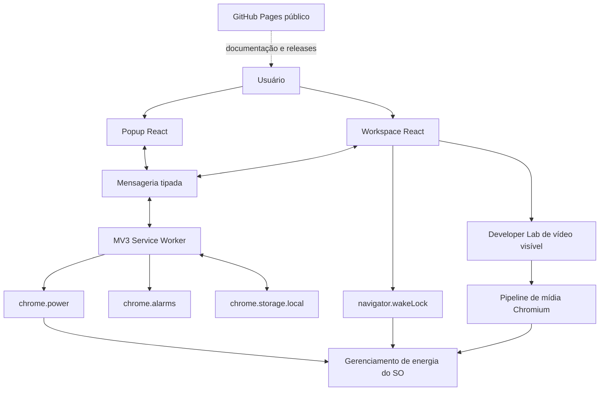
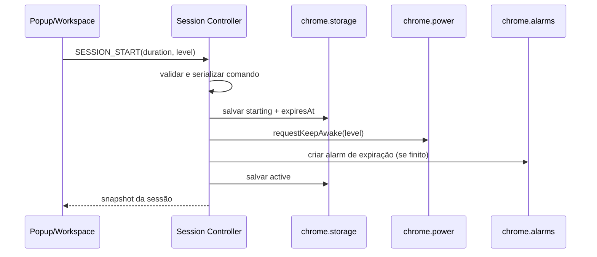
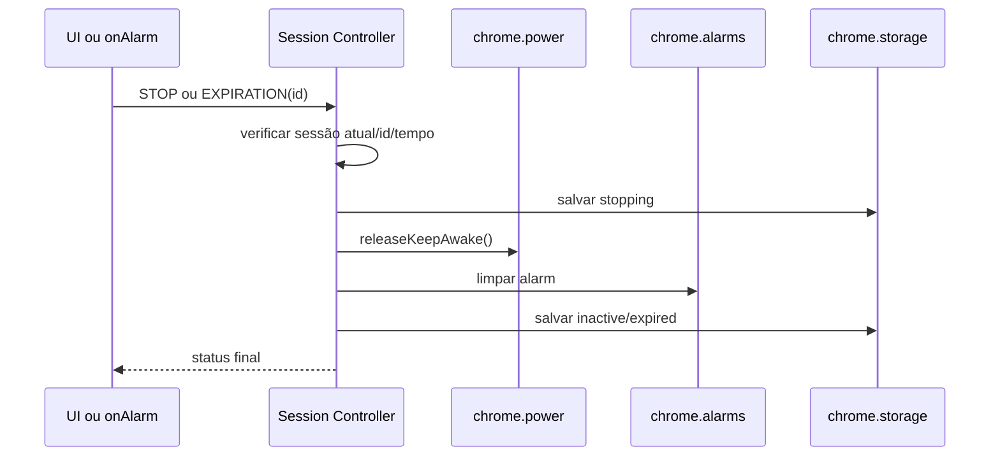

> Referência histórica fornecida pelo mantenedor. Snapshot anterior às correções de estabilização. Para estado corrente, consulte [direção de produto](../product-direction.md) e [validação](../testing/stabilization.md). Os comandos, status e instruções deste snapshot não substituem esses documentos nem os workflows atuais.

# Stay Awake — Direção de Produto, Arquitetura e Plano de Estabilização

> **Status:** código-fonte v1.0.0 implementado; **release estável ainda NÃO homologada**\
> **Versão deste documento:** 1.1 — auditoria da implementação e planejamento atualizado\
> **Atualizado em:** 16 de outubro de 2026; baseline original de 15/10/2026\
> **Plataformas-alvo:** Google Chrome e Microsoft Edge (desktop, Windows inicialmente)\
> **Distribuição inicial:** extensão local descompactada, sem publicação em lojas\
> **Stack implementada:** Manifest V3 · React 19 · TypeScript · Vite 6 · npm workspaces · Tailwind CSS 3 · Radix Switch · Remix Icon (componentes próprios; uso amplo de shadcn/ui ainda não comprovado)\
> **Escopo de uso:** computador pessoal; o uso em ambientes administrados depende das políticas e autorizações pertinentes.

---

## 0. Como utilizar este documento

Este arquivo é a **referência de produto, arquitetura, implementação existente e próximos trabalhos** do Stay Awake. O agente executor **deve partir do repositório real e não reimplementar funcionalidades presentes**. Os achados da auditoria no item 0.1 e o backlog atualizado prevalecem sobre trechos da baseline conceitual ainda formulados no futuro. Divergências devem ser registradas em ADRs e evidenciadas por testes.

**Legenda de situação:**

- **[DECIDIDO]** — diretriz adotada para a versão inicial.
- **[VALIDAR]** — depende de experimento e/ou verificação em ambiente real.
- **[FUTURO]** — possível evolução, fora do MVP.
- **[NÃO ESCOPO]** — explicitamente excluído.

**Ordem de autoridade:** segurança e APIs públicas dos navegadores → código e evidências reais da `main` auditada → critérios de aceite e pendências deste documento → ADRs → preferências visuais → hipóteses de laboratório. Se uma solicitação de energia for recusada pelo sistema, o produto deve registrar e explicar a limitação, não mascará-la.

---

## 0.1. Estado auditado e autoridade da evidência — 16/10/2026

> **REGRA DE LEITURA:** nesta revisão, **[IMPLEMENTADO]** significa presente no código, **[VERIFICADO-CI]** significa executado com sucesso no workflow inspecionado, **[TESTADO-UNIT]** significa caso coberto por teste em execução, **[NÃO HOMOLOGADO]** significa sem evidência de comportamento real em Chrome/Edge/Windows, **[RISCO IDENTIFICADO]** é potencial defeito fundamentado no código e ainda não necessariamente reproduzido.

- **Repositório remoto real:** [`lucandradeforte/stay-awake`](https://github.com/lucandradeforte/stay-awake), público, `main`, hospedado no GitHub; não é mais uma proposta de criação.
- **Commit de referência:** [`37a205519e55b3fa812cf6fedcc4c258987bd368`](https://github.com/lucandradeforte/stay-awake/commit/37a205519e55b3fa812cf6fedcc4c258987bd368) (fix de imports, ESLint, hooks e media cleanup). Auditoria é um *snapshot* deste commit; novos commits exigem reconciliação.
- **CI:** [workflow #38847120034](https://github.com/lucandradeforte/stay-awake/actions/runs/38847120034) **success**: `npm ci`, TypeScript, ESLint, unitários, builds e verificação do manifesto, Node 22, na branch acima. O CI **não inclui** `npm run test:e2e` nem teste Windows/Edge físico.
- **GitHub Pages:** [workflow #38847469795](https://github.com/lucandradeforte/stay-awake/actions/runs/38847469795) **success**, com etapa `deploy-pages` aprovada. A URL pública prevista é [`https://lucandradeforte.github.io/stay-awake/`](https://lucandradeforte.github.io/stay-awake/); a **abertura e navegação pública da URL não foram confirmadas** nesta auditoria.
- **GitHub Releases:** consulta à coleção `/releases` retornou **lista vazia** no momento da auditoria. **Não publicar tag `v1.0.0` antes do Quality Gate.** O `version: 1.0.0` do código/manifesto é *versão declarada*, não prova de release estável.
- **Testes atuais:** 11 testes Vitest em `tests/contracts.test.ts` (6) e `tests/controller.test.ts` (5); último log local apresentado pelo mantenedor confirmou 11/11 e build Vite, e a CI remota posterior passou. `tests/e2e/extension.spec.ts` possui 2 cenários escritos, **sem evidência de execução**.
- **Base técnica existente:** popup dark, Workspace dark/light, chrome.power, storage, alarms, controle de sessão, Wake Lock opcional, Developer Lab HTML5, website Vite e workflows.
- **Status do produto:** **beta técnica em estabilização / release candidate pendente**, não declarar “V1.0 homologada”.

### Quadro de maturidade

| Área | Implementação | Evidência | Decisão |
|---|---|---|---|
| Core `chrome.power` + Start/Stop | [IMPLEMENTADO] | Unitário e CI verde | Homologar em Chrome e Edge |
| Persistência, alarmes, recuperação | [IMPLEMENTADO] | Cobertura parcial | Adicionar falhas, restart, concorrência e browser real |
| Popup / Workspace / temas | [IMPLEMENTADO] | Build CI | Smoke e QA de acessibilidade |
| Screen Wake Lock | [IMPLEMENTADO] | Inspeção de código | Testar visibilidade e revogação |
| Developer Lab de vídeo | [IMPLEMENTADO] | Inspeção de código | Corrigir corridas assíncronas, testar falhas |
| Site no GitHub Pages | [IMPLEMENTADO] | Deploy Action verde | Validar URL, links, responsividade |
| Pacote ZIP / SHA-256 | [IMPLEMENTADO] | Script inspecionado | Executar pipeline/tag após QA |
| Release GitHub `v1.0.0` | [PENDENTE] | Releases vazias | Bloqueada até gate |
| Chrome real, Edge real, Windows | [NÃO HOMOLOGADO] | Sem matriz preenchida | Bloqueante |

---

## 1. Resumo executivo

**Stay Awake** é uma extensão pessoal para navegadores Chromium que permite solicitar que a tela e/ou o sistema permaneçam ativos por um período determinado ou até desligamento manual. A operação central usa a API pública `chrome.power` e independe de manter um popup aberto.

A extensão também oferece um **Workspace** (página própria da extensão) para acompanhar a sessão, consultar diagnósticos, escolher tema e explorar uma segunda via técnica, a **Screen Wake Lock API**, válida apenas em documentos elegíveis e visíveis. Um **Developer Lab**, desativado por padrão, testa reprodução visível de vídeo HTML5 como experimento de comportamento do navegador; não substitui o mecanismo principal.

O produto **já utiliza uma única base de código** para Chrome e Edge, com distribuição por ZIP do build e instalação manual via **Carregar sem compactação / Load unpacked**. Um website público, cujo deploy via **GitHub Pages** já passou na CI, apresenta o produto, documentação e instruções; releases ainda precisam ser publicadas; **o website não é a extensão** e não recebe permissões da API `chrome.power`.

### 1.1 Proposta de valor

- Ativação e desativação em poucos cliques.
- Temporizadores claros: predefinidos, personalizados e sem prazo.
- Distinção explícita entre **manter tela ligada** e **impedir suspensão**.
- Interface dark-first, minimalista e acessível.
- Workspace informativo e laboratório experimental isolado.
- Privacidade por padrão: sem conta, servidor ou telemetria compulsória.
- Código e distribuição reaproveitáveis entre Chrome e Edge.

### 1.2 Limite fundamental

`chrome.power` e `navigator.wakeLock` **solicitam gerenciamento de energia**, mas **não garantem que uma sessão do Windows permaneça desbloqueada** frente a políticas independentes, bloqueio manual (`Win + L`), troca de usuário, exigência de autenticação, eventos do SO ou administração corporativa. É proibido apresentar a funcionalidade como “desativar bloqueio de segurança do Windows”. Não serão implementadas emulação de mouse/teclado, interceptação de políticas nem alteração do Registro/energia do SO.

### 1.3 Métricas de sucesso propostas

1. Uma sessão de 1 hora pode ser iniciada e encerrada pelo popup sem manter popup ou Workspace abertos.
2. O vencimento do prazo libera a solicitação no navegador em testes funcionais e retorna a estado inativo.
3. Recuperação consistente após terminação do service worker, recarga da extensão e reinicialização do navegador, conforme as políticas de recuperação definidas.
4. Chrome e Edge executam o mesmo bundle com os mesmos fluxos essenciais.
5. Nenhuma permissão de leitura de sites, histórico, abas ou conteúdo da navegação é exigida para o núcleo.
6. O site público permite encontrar release, verificar versão e instalar localmente a extensão.

---

## 2. Público, contexto e problemas

### 2.1 Público primário

Pessoa usuária de PC Windows que precisa manter tela e/ou máquina acordadas durante apresentações, leitura, acompanhamento de longas tarefas, downloads, monitoramentos e execuções que não devam sofrer suspensão automática por inatividade.

### 2.2 Problemas

- Os tempos de suspensão do SO nem sempre refletem a necessidade temporária de trabalho.
- Manter um vídeo externo aberto é um workaround pouco transparente e dependente do comportamento do navegador.
- Soluções alternativas podem exigir instalação de executáveis, privilégios adicionais ou alterações globais de energia.
- É difícil distinguir uma solicitação enviada ao sistema de um resultado efetivamente observado.

### 2.3 Jobs to be done

- **Quando** inicio uma atividade longa, **quero** escolher por quanto tempo a tela ficará ativa, **para** não precisar modificar o plano de energia do Windows.
- **Quando** a atividade termina, **quero** que a ferramenta libere seu bloqueio de energia automaticamente.
- **Quando** preciso entender uma falha, **quero** consultar modo, estado, horário de expiração e limitações.
- **Quando** quero estudar o comportamento do Chrome, **quero** comparar a API de energia com Wake Lock e vídeo HTML5 em um laboratório identificado.

---

## 3. Escopo e fronteiras

### 3.1 Incluído no escopo da V1 (implementado em código; ver 0.1 para validações)

- Popup dark fixo, responsivo, com controle de sessão.
- Perfil `display` como padrão; `system` como opção avançada.
- Durações: 15, 30, 60, 120, 240 e 480 minutos; opção personalizada; ilimitado por escolha explícita.
- Persistência de preferências e estado desejado.
- Temporização com `chrome.alarms` e timestamp absoluto (`expiresAt`).
- Mensageria tipada entre popup, Workspace e service worker.
- Badge/ícone de status em toolbar e estado de falha visível.
- Comando inequívoco **Parar sessão**.
- Workspace próprio em aba, contendo relógio/contador, estado, ajuda e diagnósticos.
- Tema dark/light **somente no Workspace**, dark padrão; popup sempre dark.
- Painel de configuração Beta/Dev desligado por padrão.
- Página de diagnóstico de Screen Wake Lock visível.
- Laboratório experimental para vídeo HTML5 visível, com controles e encerramento explícito (pode entrar após o MVP principal).
- Build local com Chrome + Edge; README, licença escolhida pelo proprietário, instruções e releases.

### 3.2 Fora de escopo do MVP

- Conta de usuário, login ou sincronização remota.
- Backend, banco de dados ou telemetria de produto em servidor.
- Publicação em Chrome Web Store ou Edge Add-ons.
- Aplicativo nativo Windows, serviços, drivers ou agentes de sistema.
- Modificação de configurações, Registro, GPO, segurança, senha ou protetor de tela do Windows.
- Simulação de atividade humana, cliques, teclado, movimento de mouse ou manipulação de presença.
- Emulação oculta e autônoma de reprodução para forçar o desbloqueio da sessão.
- Chamada direta a `CreateVideoPowerSaveBlocker` (função interna do Chromium, não uma API JS pública).
- Forçar comportamento em Chrome fechado ou após encerramento de todas as instâncias do navegador.

### 3.3 Diretrizes de confiança

O produto informa **“solicitação de tela ativa enviada”** ou **“sessão da extensão ativa”**, e não **“Windows garantidamente desbloqueado”**. O status visual distingue estado desejado, execução da API e observação externa não disponível.

---

## 4. Fundamentos técnicos e viabilidade

### 4.1 `chrome.power` — mecanismo principal [DECIDIDO]

API pública para extensão Chromium com permissão `power`:

```ts
chrome.power.requestKeepAwake('display'); // solicita tela + sistema acordados
chrome.power.requestKeepAwake('system');  // solicita sistema acordado, permitindo apagar a tela
chrome.power.releaseKeepAwake();          // libera a solicitação da extensão
```

- `display`: solicita impedir escurecimento/desligamento do monitor e suspensão decorrentes de inatividade.
- `system`: solicita impedir suspensão por inatividade, mas permite desligar a tela.
- Chamar `requestKeepAwake` novamente pela mesma extensão substitui seu nível anterior.
- A solicitação não implica que o Windows aceite todas as consequências nem representa atividade humana.
- Não usar `chrome.power.reportActivity()` como estratégia: a documentação oficial o restringe a ChromeOS, e não é o mecanismo certo para Windows.
- **Questão a validar:** ciclo de vida da solicitação entre service worker ocioso, eventos de navegador, reload e Edge; não inferir estado nativo exclusivamente de um booleano salvo.

Fonte: https://developer.chrome.com/docs/extensions/reference/api/power

### 4.2 `navigator.wakeLock` — complementar [DECIDIDO]

```ts
const sentinel = await navigator.wakeLock.request('screen');
await sentinel.release();
```

- Requer contexto seguro e **documento visível**; apropriado para a página Workspace aberta em foreground.
- Sentinel pode ser liberado/revogado pelo navegador ou plataforma; observar `release` e `document.visibilityState`.
- Não funciona de forma persistente em service worker MV3; não pressupor que sobrevive à aba oculta.
- Deve ser opt-in no Workspace e nunca contabilizado como proteção principal quando a página estiver oculta.
- Ao retornar à visibilidade, **somente reaquisição consentida e limitada à sessão ainda ativa**.

Fontes: https://developer.mozilla.org/en-US/docs/Web/API/Screen_Wake_Lock_API e https://developer.mozilla.org/en-US/docs/Web/API/WakeLock/request

### 4.3 Reprodução de vídeo HTML5 — Developer Lab [EXPERIMENTAL]

O Chromium pode criar um bloqueador de economia de energia durante reprodução de vídeo. O componente nativo conhecido historicamente como `CreateVideoPowerSaveBlocker` pertence ao motor do navegador. **Não é exportado para JavaScript nem invocado diretamente pela extensão.**

Experimentos propostos, sempre em uma **página de laboratório visível**:

1. Reprodução de um vídeo MP4/WebM local, empacotado ou selecionado pelo usuário, com controles explícitos.
2. Experimento opcional de `canvas.captureStream()` ligado a `<video>` visível, identificando a origem gerada.
3. Comparação manual com `chrome.power` e Screen Wake Lock isolados; nunca presumir que um vídeo criado programaticamente será tratado como YouTube.
4. Mostrar `playing`, `paused`, `ended`, erro e `document.visibilityState`, com botão **Parar experimento** que pausa/descarrega o stream.

**Proibido no laboratório:** reprodução invisível/silenciosa em segundo plano destinada a falsificar presença, extensões que injetam vídeos em páginas de terceiros ou tentativas de neutralizar bloqueio de sessão configurado pelo administrador do SO.

### 4.4 Comparação resumida

| Mecanismo | Contexto | Benefício | Restrição | Categoria |
|---|---|---|---|---|
| `chrome.power('display')` | Serviço da extensão | Tela/sistema ativos sem aba | Solicitação, não garantia de desbloqueio | Core |
| `chrome.power('system')` | Serviço da extensão | Sistema acordado com tela livre para apagar | Não mantém tela ligada | Core opcional |
| `navigator.wakeLock('screen')` | Documento visível | Segunda solicitação por API Web | Liberável ao ocultar aba | Workspace |
| `<video>` HTML5 | Página visível | Teste do pipeline de mídia | Heurísticas internas não contratadas | Beta/Dev |

### 4.5 Suporte Chrome e Edge [DECIDIDO]

Edge baseado em Chromium documenta suporte às APIs de extensão `power`, `alarms` e `storage` em Manifest V3 no desktop. Portanto, **adotar build único** com feature detection e testes separados.

- Preferir `chrome.*` como API pública comum no projeto.
- Validar versões mínimas em laboratório; não congelar versões do navegador sem teste real.
- Não assumir paridade em flags experimentais ou propriedades recém-introduzidas.
- **Especialmente `chrome.alarms.persistAcrossSessions`:** propriedade recente do Chrome e não amplamente portável; não depender dela. Recriar alarmes a partir do estado persistido quando o worker acordar.
- Não usar `update_url` exclusivo de loja e nem integrar processos de aprovação de lojas neste momento.
- Chrome e Edge podem apresentar nomes e mensagens de developer mode diferentes.

Fontes: https://learn.microsoft.com/en-us/microsoft-edge/extensions/developer-guide/api-support e https://learn.microsoft.com/en-us/microsoft-edge/extensions/developer-guide/port-chrome-extension

---

## 5. Requisitos funcionais (RF)

| ID | Requisito | Prioridade | Critério objetivo de aceite |
|---|---|---|---|
| RF-01 | Iniciar sessão `display` | P0 | Clique envia pedido `power`, grava sessão e exibe estado solicitado |
| RF-02 | Encerrar sessão | P0 | Clique libera `power`, limpa alarme e persiste `inactive` |
| RF-03 | Presets de duração | P0 | 15/30/60/120/240/480 min disponíveis no popup |
| RF-04 | Duração personalizada | P1 | Entrada validada, não negativa e dentro de limite configurável |
| RF-05 | Sessão indefinida | P1 | Requer seleção explícita, badge de aviso e encerramento manual |
| RF-06 | Vencimento automático | P0 | Expiração libera solicitação assim que evento elegível é processado |
| RF-07 | Recuperação do worker | P0 | Ao acordar, compara `expiresAt` e reconstitui/remedia o estado |
| RF-08 | Estado no popup | P0 | Exibe modo, início, duração, expiração e erro quando existente |
| RF-09 | Estado no ícone/badge | P1 | Indicador ativo/inativo/atenção consistente |
| RF-10 | Página Workspace | P1 | Abre aba da extensão, compartilhando estado com popup |
| RF-11 | Tema no Workspace | P1 | Dark padrão e light opt-in persistido |
| RF-12 | Wake Lock na página | P1 | Solicitação visível com tratamento de release/erro/ocultação |
| RF-13 | Diagnóstico de sessão | P1 | Exibe dados de runtime, engine e cronologia sem PII |
| RF-14 | Ativar recursos Beta/Dev | P1 | Opt-in, descrição dos riscos, desligado por padrão |
| RF-15 | Player experimental | P2 | Mídia visível, play/pause/stop e estado mostrado |
| RF-16 | Seleção `system` | P1 | Permite conservar sistema acordado sem forçar tela ligada |
| RF-17 | Ajuda e documentação | P1 | Link para tutorial público e explicação de limitações |
| RF-18 | Instalação Chrome e Edge | P0 | Mesmo artefato `dist/` carrega em ambos navegadores |
| RF-19 | Opção de feedback | P2 | Abre página pública para registrar issue; não envia logs automaticamente |
| RF-20 | Desinstalação limpa | P0 | Nenhum processo nativo, alteração de Windows ou dado remoto remanescente |

### 5.1 Regras de duração

- Seleção de duração deve preceder ativação; padrão sugerido de **60 min**.
- Duração personalizada entre **1 min e 24 h**, validada no worker. Valores acima disso exigem modo indefinido.
- Mudança de duração durante sessão é operação explícita de **reiniciar prazo** e registra `updatedAt`.
- Alarme pontual usa **tempo absoluto** (`when: expiresAt`) e não `setTimeout` duradouro.
- Alarmes podem disparar depois do horário previsto, inclusive após suspensão; exibimos **atraso observado** e resolvemos o estado na primeira oportunidade disponível.
- Sem garantia de precisão de segundos no encerramento: a expiração operacional respeita as características do `chrome.alarms`.

### 5.2 Regras de reinicialização [DECIDIDO]

Política conservadora proposta:

- **Service worker interrompido:** sessão permanece desejada; worker reconcilia assim que for ativado; reconstitui alarme perdido.
- **Navegador fechado e reaberto:** `expiresAt` passado ⇒ inativo; `expiresAt` futuro ⇒ recuperar solicitação somente se a opção `resumeOnBrowserRestart` estiver ativa. Padrão: **desativada** (fail-safe). Sessão indefinida não retoma automaticamente sem opt-in separado.
- **Reload/atualização da extensão:** limpar estado transitório, reconciliar sem deixar badge enganoso e solicitar novamente somente quando autorizado pela preferência.
- **Erros de API:** não anunciar sucesso sem tratar erro de chamada e atualizar diagnóstico; tratar status de hardware como não verificável externamente.

### 5.3 Estados da sessão

```text
inactive ─── START ───> starting ─── SUCCESS ───> active
    ^                       │                     │
    │                       └── ERROR ───────────> error
    │                                             │
    └──── STOP / EXPIRE <──── stopping <──────────┘

active ─── worker restart ───> reconciling ───> active | inactive | error
active ─── browser quit ────> pending recovery according to preference
```

Estados exigidos: `inactive`, `starting`, `active`, `stopping`, `expired`, `reconciling`, `error`.

---

## 6. Requisitos não funcionais (RNF)

| ID | Categoria | Definição |
|---|---|---|
| RNF-01 | Privacidade | Nenhuma coleta remota de atividade ou identificador por padrão |
| RNF-02 | Segurança | Permissões mínimas: `power`, `storage`, `alarms`; extras somente com justificativa |
| RNF-03 | Compatibilidade | Smoke test obrigatório em Chrome e Edge desktop suportados |
| RNF-04 | Performance | Popup responsivo; sem polling agressivo; worker event-driven |
| RNF-05 | Acessibilidade | Teclado, foco visível, labels, contraste WCAG AA como meta |
| RNF-06 | Qualidade | TypeScript `strict`, lint, unitário, integração e E2E |
| RNF-07 | Resiliência | Estado persistido sem depender de memória volátil de service worker |
| RNF-08 | Transparência | Mostrar limitação de bloqueio e suspensão do SO de forma contextual |
| RNF-09 | Offline | Popup e Workspace operam sem rede; documentação pública pode exigir internet |
| RNF-10 | Manutenção | Arquitetura modular sem abstrações desnecessárias; dependências atualizáveis |
| RNF-11 | Consistência | Uma fonte de verdade no background; UI React não comanda SO diretamente |
| RNF-12 | Distribuição | ZIP reproduzível, versão semântica, checksum SHA-256 por release |

### 6.1 Permissões e privacidade

**Manifest base (exemplo conceitual):**

```json
{
  "manifest_version": 3,
  "name": "Stay Awake",
  "version": "0.1.0",
  "description": "Controle local de solicitações de energia da tela e sistema.",
  "permissions": ["power", "storage", "alarms"],
  "background": {
    "service_worker": "background.js",
    "type": "module"
  },
  "action": {
    "default_popup": "popup.html"
  },
  "options_page": "workspace.html"
}
```

**Observação:** caminhos e declaração exata de `options_page`/ícones serão confirmados no bundle real do Vite. A página Workspace pode ser aberta programaticamente por `chrome.runtime.getURL('workspace.html')` em uma aba, a partir de ação explícita. **Evitar permissão `tabs`** se `chrome.tabs.create` funcionar sem ela para abrir essa própria URL (validar no target). Não solicitar `<all_urls>`, `history`, `scripting`, `webRequest`, `nativeMessaging` ou host permissions sem requisito concreto.

### 6.2 Política de logs

- Eventos locais: horário, tipo, origem (`popup`/`workspace`/`background`), modo e resultado.
- Não registrar URLs visitadas, títulos de abas, texto copiado ou identidade do SO.
- Logs de erro são temporários/limitados, com opção **copiar relatório sanitizado**.
- `chrome.storage.local` mantém apenas preferências e estado; diagnóstico detalhado preferencialmente em buffer limitado.
- Excluir dados locais via configurações e ao desinstalar pelo próprio navegador.

---

## 7. Arquitetura de referência

### 7.1 Diagrama de contexto



### 7.2 Fronteiras

1. **UI**: obtém dados e envia comandos; não é autoridade para gerenciamento de energia.
2. **Background/Application**: valida entrada, serializa transições, emite comandos às APIs e mantém estado desejado.
3. **Infraestrutura do navegador**: adaptadores `chrome.power`, `chrome.alarms`, `chrome.storage`.
4. **Workspace experimental**: possui ciclo de vida próprio para Wake Lock e player visível.
5. **GitHub Pages**: aplicação estática pública e independente, sem privilégios de extensão.

### 7.3 Estrutura de referência (histórica; diferenças reais no item 19)

```text
stay-awake/
├── .github/
│   └── workflows/
│       ├── ci.yml
│       ├── release.yml
│       └── pages.yml
├── apps/
│   ├── extension/
│   │   ├── public/
│   │   │   ├── manifest.json
│   │   │   ├── icons/
│   │   │   └── media/              # somente assets locais consentidos
│   │   ├── src/
│   │   │   ├── background/
│   │   │   │   ├── index.ts
│   │   │   │   ├── session-controller.ts
│   │   │   │   ├── power-adapter.ts
│   │   │   │   └── alarm-adapter.ts
│   │   │   ├── entries/
│   │   │   │   ├── popup/
│   │   │   │   └── workspace/
│   │   │   ├── features/
│   │   │   │   ├── session/
│   │   │   │   ├── power/
│   │   │   │   ├── diagnostics/
│   │   │   │   ├── wake-lock/
│   │   │   │   ├── developer-lab/
│   │   │   │   └── settings/
│   │   │   ├── components/ui/
│   │   │   ├── lib/browser/
│   │   │   ├── styles/
│   │   │   └── types/
│   │   ├── popup.html
│   │   ├── workspace.html
│   │   ├── vite.config.ts
│   │   └── package.json
│   └── website/
│       ├── src/
│       ├── public/
│       ├── vite.config.ts
│       └── package.json
├── packages/
│   ├── contracts/                 # tipos puros e schema da sessão
│   └── design-tokens/             # tokens compartilháveis, sem importar código privilegiado
├── docs/
│   ├── architecture/
│   │   ├── ADR-001-extension-first.md
│   │   ├── ADR-002-power-engine.md
│   │   ├── ADR-003-cross-browser.md
│   │   └── ADR-004-hosting-distribution.md
│   ├── product/
│   ├── design/
│   ├── testing/
│   └── release/
├── tests/
│   ├── unit/
│   ├── integration/
│   └── e2e/
├── package.json
├── package-lock.json             # npm workspaces, implementado
├── README.md
├── CHANGELOG.md
└── LICENSE
```

**Justificativa do monorepo leve:** reusar tokens visuais e contratos entre extensão e site, sem forçar Next.js nem backend. Para um protótipo minúsculo seria aceitável um repositório plano; esta estrutura é a recomendação para a trajetória V1 + website público. Evitar circularidade entre `apps` e `packages`.

### 7.4 Stack de referência (substituições reais indicadas abaixo)

| Área | Tecnologia | Motivo |
|---|---|---|
| Linguagem | TypeScript strict | Contratos fortes e manutenção |
| Extensão | Manifest V3 | Plataforma atual Chromium |
| UI | React | Componentização e estado declarativo |
| Bundler | Vite com entradas múltiplas configuradas | Build local eficiente |
| CSS | Tailwind CSS | Tokens, utilitários e dark-first |
| Componentes | Componentes próprios + Radix Switch (shadcn/ui é direção visual, não instalação ampla verificada) | Acessibilidade e customização |
| Ícones | Remix Icon | Identidade consistente |
| Estado transitório | React hooks / Zustand somente quando necessário | Sem estado duplicado autoritativo |
| Estado durável | chrome.storage.local | Disponível ao background e interfaces |
| Agendamento | chrome.alarms | Sobrevive à dormência do worker via eventos; reconciliação necessária |
| Core energia | chrome.power | API pública documentada |
| API Web complementar | navigator.wakeLock | Experimento visível |
| Validação de mensagens | Zod ou parser equivalente | Dados e comandos validados em runtime |
| Unitário | Vitest | Testes determinísticos |
| E2E | Playwright + cenários manuais de extensão | Automação em Chromium; Edge requer validação real |
| Docs web | Vite + React (estático) | GitHub Pages sem SSR/backend |
| CI | GitHub Actions | Lint, testes, build, release e Pages |
| Package manager | **npm workspaces + package-lock.json v3 (IMPLEMENTADO)** | Build reprodutível com `npm ci` |

### 7.5 Contratos de domínio

**Modelo conceitual, sujeito a refinamento:**

```ts
type KeepAwakeLevel = 'display' | 'system';
type SessionStatus =
  | 'inactive' | 'starting' | 'active' | 'stopping'
  | 'expired' | 'reconciling' | 'error';

type StayAwakeSession = {
  schemaVersion: 1;
  id: string;
  status: SessionStatus;
  level: KeepAwakeLevel;
  durationMinutes: number | null; // null = indefinido
  startedAt: number | null;
  expiresAt: number | null;
  updatedAt: number;
  lastError?: { code: string; message: string; at: number };
};

type Preferences = {
  defaultDurationMinutes: number;
  defaultLevel: KeepAwakeLevel;
  workspaceTheme: 'dark' | 'light';
  developerModeEnabled: boolean;
  resumeOnBrowserRestart: boolean;
  resumeUnlimitedOnRestart: boolean;
};

type SessionCommand =
  | { type: 'SESSION_START'; level: KeepAwakeLevel; durationMinutes: number | null }
  | { type: 'SESSION_STOP' }
  | { type: 'SESSION_GET' }
  | { type: 'SESSION_UPDATE_DURATION'; durationMinutes: number | null };
```

- `id` impede confusão com alarms pertencentes a sessões anteriores.
- Timestamps são milissegundos UNIX; tempos exibidos no timezone local.
- Não confiar em dados de mensagens sem validação; evitar corridas Start/Stop e expirations antigas.
- Guardar `expiresAt`, não apenas “faltam 60 min”.
- Escrever estado `starting` antes da ativação e confirmar `active` depois; erros levam a `error` e tentativa controlada de liberação.

### 7.6 Fluxo START



### 7.7 Fluxo STOP/EXPIRATION



### 7.8 Recuperação após worker ocioso

O service worker MV3 é **event-driven** e pode ser encerrado por inatividade. Proibição de pressupor um processo em memória permanentemente ativo. Reconciliar em `onStartup`, `onInstalled`, `onAlarm` e quando necessário ao receber mensagens/abrir popup.

**Política de reconciliação:**

1. Carregar snapshot local e versão do schema.
2. Identificar se sessão foi interrompida, expirada, abandonada ou requer retomar conforme preferência.
3. Se `expiresAt <= now`, liberar solicitação se necessário, limpar alarm e marcar expirada.
4. Se válida e autorizada, reemitir `requestKeepAwake(level)` de forma idempotente e garantir existência de alarme.
5. Se não autorizada a retomada (reinício completo), liberar e marcar inativa.
6. Reconciliar indicador do popup/toolbar; nunca rotular como hardware garantidamente acordado.

**Risco técnico a validar em POC:** diferenciar o evento `onStartup` de mero despertar do worker e os efeitos de recarregar/desativar a extensão. É possível que a API nativa preserve ou libere sua solicitação em eventos diferentes. Criar testes específicos para isso antes de finalizar comportamento do modo ilimitado.

---

## 8. UX, navegação e interfaces

### 8.1 Princípios de design [DECIDIDO]

Referências conceituais: [Vercel](https://vercel.com/), [Next.js](https://nextjs.org/), [shadcn/ui](https://ui.shadcn.com/), [GitHub](https://github.com/). **Inspirar-se em clareza e composição, não copiar marca, ícones proprietários ou layouts integralmente.**

1. Minimalismo funcional: informação suficiente, sem painéis supérfluos.
2. Dark-first confortável: grafite em vez de preto absoluto como única superfície.
3. Estados sem ambiguidade: cor + texto + ícone (nunca só cor).
4. Hierarquia enxuta: nome, estado, duração, ação principal e detalhes.
5. Botões grandes, foco visível e microinterações contidas.
6. Movimento reduzido com `prefers-reduced-motion`; nada de efeitos contínuos que aumentem carga de CPU.
7. Idioma inicial: português-BR; conteúdo preparado para i18n futuro.

### 8.2 Identidade visual

**Nome:** Stay Awake (provisório, verificar disponibilidade de marca e conflitos antes de publicação ampla).

**Personalidade:** utilitário confiável, discreto, tecnológico, claro. Não usar linguagem que implique hack, bypass ou desbloqueio de segurança.

**Paleta — dark (sugestão):**

| Token | Hex | Uso |
|---|---|---|
| `--bg` | `#0B0D10` | Fundo principal |
| `--surface` | `#111419` | Cartões e painel |
| `--surface-elevated` | `#1A1F26` | Popovers, hover |
| `--border` | `#292F38` | Divisores, inputs |
| `--text` | `#E7EAF0` | Texto principal |
| `--text-muted` | `#9AA4B2` | Textos secundários |
| `--accent` | `#8FDCB1` | Ativo/sucesso/acento |
| `--accent-dark` | `#244A37` | Fundo de botão ativo |
| `--warning` | `#E7C479` | Beta, energia, risco |
| `--error` | `#EF8E8E` | Falha |

**Paleta — light (apenas Workspace):**

| Token | Hex |
|---|---|
| `--bg` | `#F7F8FA` |
| `--surface` | `#FFFFFF` |
| `--border` | `#DFE3E8` |
| `--text` | `#171B20` |
| `--text-muted` | `#5F6875` |
| `--accent` | `#276749` |

**Tipografia:** `Geist` caso sua licença de distribuição esteja compatível com a build; fallback `Inter`, `Segoe UI`, `system-ui`, `sans-serif`; números tabulares no cronômetro. Fontes devem ser empacotadas localmente na extensão; não depender de CDN.

**Grid/forma:** spacing 4px base; radius 8–12px para cards, 999px para chips; bordas finas; sombra mínima; transições 120–180ms quando não houver preferência por movimento reduzido.

### 8.3 Mapa de telas

```text
Extensão
├── Popup (sempre dark)
│   ├── Home / Sessão
│   ├── Duração e modo
│   ├── Ações Start / Stop
│   └── Acesso ao Workspace
└── Workspace (dark padrão / light opcional)
    ├── Overview / Sessão de espera
    ├── Diagnostics
    ├── Developer Lab [Beta/Dev, opt-in]
    ├── Settings
    └── Help & About

Website GitHub Pages (público)
├── Landing
├── Features
├── Installation (Chrome e Edge)
├── FAQ e Troubleshooting
├── Changelog
└── Links para GitHub Releases e Issues
```

### 8.4 Popup — especificação

**Dimensões sugeridas:** 360–400px largura; altura compacta sem rolagem no caso básico.

Ordem visual:

1. Header: ícone, Stay Awake, Settings.
2. Status hero: OFF/ACTIVE/PENDING/ERROR com botão de energia grande.
3. Escolha de duração: 15, 30, 60, 120 min, custom, unlimited; 4/8 h em grupo avançado ou segunda linha.
4. Modo de energia: `display` padrão; `system` em disclosure de opções avançadas.
5. Detalhes: engine, horário de expiração, tempo restante.
6. CTA Start/Stop; rodapé: **Abrir Workspace**, versão.

**Labels:** “Manter tela ligada”, “Somente impedir suspensão”, “Até eu desativar”, “Parar sessão”, “Solicitação ativa”. Evitar “desbloqueado garantido”.

**Comportamentos:** botão desabilitado durante `starting/stopping`; confirmar mudança de modo em sessão ativa; erros com retry; atualização por mensagem e `chrome.storage.onChanged`, sem múltiplas sources of truth.

### 8.5 Workspace — especificação

Header enxuto, navegação por tabs (Sessão, Diagnósticos, Laboratório [condicional], Configurações), botão de alternância dark/light, versão.

**Overview:**

- Título “Seu espaço, sem interrupções desnecessárias”.
- Status de engine e timer destacado.
- Relógio local opcional e contador com tabular numerals.
- Cartão informativo sobre o que a extensão controla.
- Botões Parar / Reiniciar prazo / Abrir diagnósticos.
- Modo apresentação (distrações reduzidas) opcional.

**Diagnósticos:**

- Versão da extensão, navegador (sem fingerprinting persistente), modo atual, horários e último erro.
- Estado do sentinel de Wake Lock **somente quando medido naquele documento**.
- Sinalizar “status do Windows não verificável pela extensão”.
- Copiar diagnóstico sanitizado.
- Checks guiados para testar comportamento de tela e suspensão sem inferir evento que a API não expõe.

**Developer Lab:**

- Entrar somente com toggle Beta/Dev ligado e aviso de natureza experimental.
- Escolha manual de engine para teste de API Web vs vídeo visível.
- Controles play/pause/stop e limpeza garantida de objetos/streams ao sair.
- Indicadores de `document.visibilityState`, eventos de mídia e status Wake Lock.
- Nunca rodar em aba escondida para reproduzir presença nem afirmar bloqueio de segurança desativado.

**Settings:** tema Workspace; presets preferidos; defaults; comportamento de retomada; toggle Beta/Dev; avisos de energia; apagar dados locais; documentação.

### 8.6 Microcopy e feedback

- Sessão inativa: “Pronto para iniciar.”
- Sessão ativa: “Solicitação de energia ativa.”
- Modo display: “Solicitando que tela e sistema permaneçam acordados.”
- Modo system: “Solicitando evitar suspensão; a tela pode apagar.”
- Sem prazo: “Ativo até você desativar. Pode aumentar consumo de bateria.”
- Wake Lock liberado: “A página deixou de estar elegível para manter a tela ativa.”
- Falha: “Não foi possível confirmar a solicitação. Consulte diagnósticos.”
- Limite: “Regras de bloqueio do Windows podem prevalecer.”

### 8.7 Acessibilidade e responsividade

- Teclado: navegação sequencial, Enter/Espaço, Esc quando aplicável.
- Contraste mínimo AA para texto comum; testar combinações de verde e cinza.
- `aria-live` apenas em mudanças importantes (não anunciar cronômetro a cada segundo).
- Estados de foco evidentes, alvos 40–44px como referência prática.
- Workspace responsivo de 320px ao desktop; popup testado em escala de SO 100/125/150%.
- Suporte a zoom e movimento reduzido; não depender exclusivamente de hover.

---

## 9. Guia de testes e validação

### 9.1 Matriz de experimentos de energia

| Teste | Chrome Power | Workspace visível | Screen Wake Lock | Vídeo visível | Resultado esperado |
|---|---:|---:|---:|---:|---|
| A — baseline | Não | Não | Não | Não | Registrar comportamento normal de referência |
| B — core | `display` | Não | Não | Não | Solicitação fica ativa sem popup |
| C — Workspace | `display` | Sim | Sim | Não | Duas solicitações elegíveis, sem garantia adicional |
| D — Web Wake Lock | Não | Sim | Sim | Não | Somente enquanto a página estiver visível |
| E — mídia | Não | Sim | Não | Sim | Verificar comportamento da reprodução real |
| F — comparativo | `display` | Sim | Sim | Sim | Comparar; não pressupor efeito cumulativo |

**Obrigatório:** executar cada experimento com mesma alimentação (tomada/bateria), timeout base conhecido, mesmas configurações e mesma versão do navegador. Observar separadamente (1) monitor, (2) suspensão, (3) bloqueio de sessão. Registar apenas os comportamentos visíveis e eventos de API; não afirmar precisão sobre o estado interno do SO.

### 9.2 Planilha de evidências (modelo)

| Campo | Exemplo de preenchimento |
|---|---|
| Browser | Chrome / Edge + versão |
| Sistema | Windows 11 + versão |
| Alimentação | Tomada / Bateria |
| Experimento | B — Core |
| Hora de início | ISO local |
| Duração | 30 min |
| Popup fechado? | Sim/Não |
| Workspace visível? | Sim/Não |
| Tela apagou? | Sim/Não/Não determinado |
| Sistema suspendeu? | Sim/Não/Não determinado |
| Sessão bloqueou? | Sim/Não/Não determinado |
| Evento de API / erro | Detalhe técnico sanitizado |
| Resultado | PASS / FAIL / INCONCLUSIVE |

### 9.3 Unit tests (Vitest)

- Máquina de estados: `start`, `stop`, `expire`, `error`, `recover`.
- Durações inválidas, enormes, fracionadas e de fronteira.
- Alarme de sessão antiga não pode encerrar sessão nova.
- `expiresAt` ultrapassado durante worker ocioso.
- Falha em `requestKeepAwake`, `releaseKeepAwake`, storage e alarm.
- Migração de schema e fallback de storage ausente/corrompido.
- Transições concorrentes (double click, popup+workspace simultâneos).
- Sanitização de erros e diagnósticos.

### 9.4 Integração e E2E

- Carregar build MV3 sem erro em Chrome e Edge.
- Abrir popup, iniciar/parar, recarregar extensão e reabrir popup.
- Terminar/reiniciar service worker; verificar estado após reconciliar.
- Fazer o alarm expirar com popup fechado.
- Testar comportamento após fechar e reabrir navegador com retomar desativado e ativado.
- Workspace acompanha alterações da sessão feitas no popup.
- Wake Lock é liberado em `visibilitychange` e `release` (quando aplicável).
- Developer Lab limpa vídeo/streams ao encerrar ou navegar para outra seção.
- Capturar screenshots dark e light e checar regressões visuais.
- E2E automatizado de extensão pode exigir contexto Chromium persistente. **Edge real precisa de smoke test manual além de possível automação.**

### 9.5 Critérios para liberar V1 (checklist NÃO preenchido; CI verde não resolve smoke de navegadores)

- [ ] Chrome e Edge carregam a mesma build com Manifest V3 válido.
- [ ] `display` e `system` acionados/liberados conforme modo.
- [ ] Nenhum timer depende de `setInterval` permanente no worker.
- [ ] `expiresAt` e recuperação de alarm testados.
- [ ] Popup funciona fechado entre Start e Stop.
- [ ] Workspace sincronizado e tem dark/light funcional.
- [ ] Todas as ações essenciais utilizáveis por teclado.
- [ ] Beta/Dev isolado, desligado por padrão e com aviso.
- [ ] Docs/release/ZIP têm versão e checksum corretos.
- [ ] README informa explicitamente os limites de bloqueio do SO.
- [ ] Nenhuma permissão além do necessário foi introduzida.

---

## 10. Segurança, riscos e mitigação

| ID | Risco | Impacto | Mitigação |
|---|---|---|---|
| R-01 | Tela fica ligada indefinidamente | Energia/bateria/OLED | Warning e botão Stop persistentes; modo ilimitado explícito |
| R-02 | Bloqueio do Windows ainda ocorre | Expectativa inadequada | Comunicação clara e testes separados |
| R-03 | Worker MV3 é interrompido | Estado inconsistente | Persistência + alarms + reconciliação |
| R-04 | Alarme não persiste entre sessões | Prazo inadequado | Recriar a partir de `expiresAt`; checar na inicialização |
| R-05 | Wake Lock revogado ao ocultar página | Falha do complemento | Eventos `release` + fallback principal; aviso |
| R-06 | Paridade Chrome/Edge incompleta | Bugs | Testes reais; feature detection |
| R-07 | Reproduzir vídeo gasta recursos | CPU/GPU/energia | Lab manual, visível, opt-in e com Stop/cleanup |
| R-08 | Build ZIP adulterado | Cadeia de suprimento | SHA-256, releases versionados, origem oficial |
| R-09 | Dependências externas/CSP MV3 | Extensão não carrega | Assets e scripts locais; auditoria de build |
| R-10 | Usuário confunde Pages com extensão | Instalação frustrada | Documentar que site não controla `chrome.power` |
| R-11 | Administração bloqueia sideload | Sem instalação | Respeitar política; uso pessoal e autorização onde aplicável |
| R-12 | Extensão muda política por acidente | Segurança | Sem Registro, comandos do Windows ou native messaging |

**Threat model resumido:** a extensão tem poder de solicitar alteração temporária de gerenciamento de energia; esse privilégio não deve ser ampliado para ler sites, controlar input, coletar dados ou executar código remoto. Evitar HTML arbitrário, dependências suspeitas e assets remotos executáveis. Respeitar CSP de Manifest V3.

---

## 11. Roadmap atualizado (estado real e próximos gates)

> O roadmap inicial de construção foi executado em grande parte por geração do código-fonte. A sequência agora deve ser orientada por **risco e evidência**, sem voltar ao bootstrap ou reescrever UI já construída.

| Fase | Estado 16/10 | Resultado atual | Critério de saída restante |
|---|---|---|---|
| F0 — Scaffold / POC | Código pronto, POC manual pendente | Manifest V3, scripts e pacotes | Chrome/Edge reais e comportamento `power` medidos |
| F1 — Core / Popup | Implementado | SessionController, tempos, UI | Falhas/recuperação e testes em navegador |
| F2 — Workspace | Implementado | Navegação, temas, diagnostics, Wake Lock | Teste visual, visibilidade e ciclo de vida |
| F3 — Developer Lab | Implementado, frágil em concorrência | Canvas + vídeo local + cleanup básico | Robustez assíncrona + 3 cenários mandatórios |
| F4 — Site / distribuição | Site implantado por Actions | Website e scripts de ZIP | URL navegável, links válidos e ZIP inspecionado |
| F5 — V1.0 Quality Gate | **Aberto** | CI verde | E2E, auditoria de dependências, QA Chrome/Edge, release |

### Sprint de estabilização S1 — corretude de runtime (P0/P1)

1. **SA-101 [P0]** — Corrigir corridas de `play()` no Developer Lab e evitar setState após unmount; cobrir falha e troca de origem.
2. **SA-102 [P0]** — Expandir testes do controlador: falha `chrome.storage`, `chrome.alarms`, requests de energia, restart, expiração, alarme obsoleto, double start/stop e erro de logs.
3. **SA-103 [P1]** — Corrigir validação de `PREFERENCES_SET.patch = null`; adicionar teste de comando malformado e armazenamento corrompido.
4. **SA-104 [P1]** — Revisar promises de dispatch na UI (não esconder rejeições com `void` após `throw`).
5. **SA-105 [P1]** — Tornar `chrome.power` + persistência de estado robustos diante de erro secundário de log/badge; evitar perda da causa raiz.

### Sprint de estabilização S2 — cadeia de suprimento e qualidade (P1)

6. **SA-106 [P1]** — Aprovar de forma seletiva o script `esbuild` na versão resolvida, após revisão, e validar `npm ci` em instalação limpa.
7. **SA-107 [P1]** — Revisar warning de depreciação de ESLint 9 e fazer atualização isolada da ferramenta *quando compatível*, sem bundling de mudanças não relacionadas.
8. **SA-108 [P1]** — Reativar **verificação explícita de vulnerabilidades** em CI: `.npmrc` hoje tem `audit=false`; realizar triagem e estabelecer política de falha.
9. **SA-109 [P1]** — Expandir Playwright E2E e executá-lo em job dedicado com browser instalado e artefatos quando falhar.

### Sprint de estabilização S3 — homologação e publicação (P0)

10. **SA-110 [P0]** — Executar QA-01..QA-20 em Google Chrome e Microsoft Edge reais; preencher matriz com evidências.
11. **SA-111 [P1]** — Validar acesso público e links no GitHub Pages, critérios WCAG e mobile/responsividade.
12. **SA-112 [P0]** — Confirmar artefato ZIP, checksum, release GitHub e atualização por sideload; só então tag `v1.0.0`.

### Backlog posterior à V1 (não bloqueante)

- Duração por horário absoluto, presets por contexto, i18n e atalhos de navegador opcionais.
- Histórico local de sessões com opt-in e retenção limitada.
- Captura facultativa de evidências de QA e relatórios sanitizados sem telemetria remota.
- Atualizações programadas de dependências em PRs isolados e documentação de compatibilidade.

---

## 12. Repositório, hospedagem, domínio e distribuição

### 12.1 Repositório em operação [CONFIRMADO]

O repositório pessoal independente **já existe**:

- GitHub: `https://github.com/lucandradeforte/stay-awake` *(repositório existente, confirmado pela integração GitHub).*
- Branch padrão: `main`.
- Desenvolvimento em branches `feat/*`, `fix/*`, `docs/*`.
- Tags `v0.1.0`, `v0.2.0`, ...
- Commits convencionais recomendados (`feat:`, `fix:`, `docs:`, `chore:`).
- Licença: escolher explicitamente (MIT é opção, não presumir antes de aprovação).

Evitar associar a ferramenta ao repositório corporativo Nexus. Não incluir nenhuma referência interna de organização, políticas ou identificadores da máquina corporativa.

### 12.2 GitHub Pages — o que pode ser hospedado

**Pode:** landing page, documentação de instalação, FAQ, changelog, screenshots, links para release, formulário de feedback via GitHub Issues, versão de demonstração visual e explicações das APIs.

**Não pode:** executar `chrome.power` diretamente do domínio `github.io`; hospedar a extensão como se uma pessoa pudesse “instalar” seu conjunto de permissões apenas visitando o site; distribuir atualização automática de extensão descompactada como se fosse uma loja.

**Estratégia em implementação:**

```text
GitHub Repo: lucandradeforte/stay-awake
├── Código-fonte / apps/extension
├── apps/website ── GitHub Actions ──> GitHub Pages
└── GitHub Releases ── stay-awake-vX.Y.Z-unpacked.zip

Website: https://lucandradeforte.github.io/stay-awake/
(deploy Actions concluído com sucesso; URL e conteúdo público ainda dependem de validação independente)
```

Alternativa se o usuário possuir repositório `lucandradeforte.github.io`: colocar a landing sob rota ou link próprio, mantendo o código da extensão no repositório `stay-awake`. Evitar acoplar build de extensão ao website principal sem necessidade.

### 12.3 GitHub Pages — já configurado no workflow; passos para manter ou recuperar

1. Abrir o repositório `stay-awake` existente no GitHub.
2. Subir o código e uma aplicação estática em `apps/website`.
3. Em `apps/website/vite.config.ts`, configurar `base: '/stay-awake/'` para o endereço de **project Pages**; se publicar no domínio raiz `username.github.io` ou domínio personalizado na raiz, usar `base: '/'`.
4. O arquivo `.github/workflows/pages.yml` já existe e está funcional; em manutenção, preservar checkout, Node, `npm ci`, build do website e ações de Pages.
5. Nas configurações do repositório: **Settings → Pages → Build and deployment → Source: GitHub Actions**.
6. Conceder no workflow permissões `contents: read`, `pages: write` e `id-token: write` e selecionar ambiente `github-pages` no job de deploy.
7. Para futuras mudanças no site, fazer push em `main` e acompanhar **Actions**; o workflow já passou na branch auditada.
8. Abrir a URL publicada e testar URLs internas em refresh (para SPA, preferir páginas estáticas geradas ou fallback compatível com GitHub Pages).
9. Publicar links de releases e tutorial; nunca incluir segredos ou dados privados nos assets do Pages.

**Pipeline real utilizado na `main` auditada (versão simplificada para referência):**

```yaml
name: Website (GitHub Pages)
on:
  push:
    branches: [main]
    paths:
      - 'apps/website/**'
      - 'packages/design-tokens/**'
      - 'package.json'
      - 'package-lock.json'
      - '.github/workflows/pages.yml'
  workflow_dispatch:
permissions:
  contents: read
  pages: write
  id-token: write
jobs:
  deploy:
    runs-on: ubuntu-latest
    environment:
      name: github-pages
      url: ${{ steps.deployment.outputs.page_url }}
    steps:
      - uses: actions/checkout@v4
      - uses: actions/setup-node@v4
        with:
          node-version: '22'
      - run: npm ci
      - run: npm run build:website
      - uses: actions/configure-pages@v5
      - uses: actions/upload-pages-artifact@v3
        with:
          path: apps/website/dist
      - id: deployment
        uses: actions/deploy-pages@v4
```

> **Resumo ilustrativo do workflow real:** para a definição integral, usar `.github/workflows/pages.yml` do repositório; o arquivo remoto também declara `concurrency` e outras opções. A execução existente já terminou com `success`, mas ainda é necessário conferir a navegação pública e links.

Fontes: https://docs.github.com/en/pages/getting-started-with-github-pages/configuring-a-publishing-source-for-your-github-pages-site e https://vite.dev/guide/static-deploy.html

### 12.4 Publicação de releases sem loja

**Artefato real previsto pelo script:** `stay-awake-v1.0.0-chrome-edge.zip`, cujo conteúdo, ao extrair, será a **pasta compilada da extensão** com `manifest.json` na raiz da pasta selecionada pelo navegador. Separar o build do website: `apps/website/dist` **não** é extensão.

1. Build determinístico da extensão: `npm run build:extension` (ajustar conforme package names).
2. Validar presença de `manifest.json`, popup, workspace, service worker e assets.
3. Criar `stay-awake-vX.Y.Z-chrome-edge.zip` contendo somente a extensão compilada, preservando estrutura de diretórios.
4. Gerar SHA-256 do ZIP e publicar o valor no release.
5. Criar tag `vX.Y.Z`, incluir changelog e anexar ZIP em **GitHub Releases**.
6. Website aponta para página do release (não inventar link de arquivo antes de publicar).
7. As atualizações de uma extensão carregada sem compactação são **manuais**: obter novo ZIP, extrair em local estável e clicar **Recarregar/Reload** no gerenciador, ou reinstalar se necessário.

**Importante sobre atualizações:** não há mecanismo de update via GitHub Pages equivalente à loja para instalações locais descompactadas. Nunca prometer atualização silenciosa ou automática.

### 12.5 Instalação local — Google Chrome

**Pré-requisito:** desktop com Chrome atualizado e permissão para usar extensões locais.

1. Quando houver release publicada, baixar o `stay-awake-vX.Y.Z-chrome-edge.zip` correspondente. Antes disso, compilar localmente.
2. Conferir SHA-256 publicado (recomendado) e extrair o ZIP para pasta persistente, por exemplo `C:\Tools\StayAwake\extension\`. **Não escolher o ZIP; escolher a pasta extraída.**
3. Verificar que existe `manifest.json` na pasta selecionada, por exemplo `C:\Tools\StayAwake\extension\manifest.json`.
4. Abrir `chrome://extensions` na barra de endereço.
5. Ativar **Modo do desenvolvedor / Developer mode**.
6. Selecionar **Carregar sem compactação / Load unpacked**.
7. Apontar para a pasta onde está `manifest.json`.
8. Confirmar que **Stay Awake** foi carregado sem erros.
9. No menu de extensões (ícone de peça de quebra-cabeça), fixar Stay Awake na barra de ferramentas.
10. Abrir popup, escolher 15 minutos, iniciar e validar o estado; depois desativar manualmente.
11. Abrir **Workspace** para testar modo claro/escuro e diagnóstico.
12. Para desenvolvimento, após reconstruir os arquivos, retornar a `chrome://extensions` e clicar **Recarregar**. Se o popup estiver aberto, fechá-lo e reabri-lo.

**Se falhar:** conferir se o ZIP foi extraído; pasta correta; manifesto válido; caminho do worker; CSS/JS realmente incluídos no build; avisos/erros em `chrome://extensions`.

Fonte: https://developer.chrome.com/docs/extensions/get-started/tutorial/hello-world

### 12.6 Instalação local — Microsoft Edge

**Pré-requisito:** Edge desktop atualizado e permissão para instalar extensões locais.

1. Baixar o mesmo ZIP de release, quando publicado, e extrair numa pasta permanente, como `C:\Tools\StayAwake\extension\` (pasta separada para testes, se necessário).
2. Abrir `edge://extensions`.
3. Habilitar **Modo de desenvolvedor / Developer mode**.
4. Selecionar **Carregar sem compactação / Load unpacked**.
5. Escolher a pasta que contém `manifest.json`.
6. Conferir instalação e permissões exibidas.
7. Fixar o ícone da extensão na barra de ferramentas.
8. Testar Start/Stop, duração, abertura de Workspace e comportamento `display`.
9. Para atualizar, substituir os arquivos compilados na pasta local e clicar **Recarregar / Reload** no card da extensão.
10. Se uma API tiver diferença no Edge, documentar e corrigir por feature detection/adapter sem criar forks arbitrários do core.

A Microsoft documenta sideload de extensões descompactadas e suporte de Edge Chromium a `power`, `alarms` e `storage` para MV3 desktop.

Fontes: https://learn.microsoft.com/en-us/microsoft-edge/extensions/getting-started/extension-sideloading e https://learn.microsoft.com/en-us/microsoft-edge/extensions/developer-guide/api-support

### 12.7 Uso local a partir do desenvolvimento (sem GitHub Release; comandos efetivos npm)

1. Clonar o repositório existente.
2. Instalar Node suportado (`>=20.19`; CI usa 22) e npm `>=10`.
3. `npm ci`.
4. `npm run build:extension` (nome final do pacote a confirmar).
5. Identificar pasta de saída da extensão, ex.: `apps/extension/dist`.
6. Chrome/Edge: Developer mode → Load unpacked → escolher **`apps/extension/dist`**.
7. Após modificar fonte, gerar novo build e acionar Reload no gerenciador.

**Não usar** URL do dev server Vite como `default_popup` para versão de distribuição. A build MV3 deve conter JavaScript, CSS e fontes localmente, respeitando Content Security Policy.

### 12.8 Troubleshooting mais frequente

| Sintoma | Causa provável | Ação |
|---|---|---|
| “Manifest missing / unreadable” | Pasta errada / ZIP não extraído | Selecionar diretório com `manifest.json` |
| Popup abre em branco | Caminhos/JS/CSP | Inspecionar popup e arquivos da build |
| Erro do service worker | Bundle não emitido ou import inválido | Ver painel de erros em `chrome://extensions`/`edge://extensions` |
| Workspace não abre | Caminho `workspace.html` incorreto | Validar `runtime.getURL` e build |
| Wake Lock rejeitado | Página oculta/restrição de plataforma | Mostrar erro e estado; não forçar |
| O Windows bloqueia | Política de segurança independente | Informar limitação; não contornar bloqueio |
| Expiração atrasada | Worker/browser dormiu ou alarme disparou tarde | Reconciliar por timestamp e exibir atraso |
| Edge não carrega | API incompatível/manifesto/CSP | Ver suporte Microsoft e reproduzir falha no Edge |
| Instalação desabilitada | Política do navegador/administrador | Utilizar somente em equipamento permitido |
| Perda de dados após reinstalação | ID/perfil da extensão alterado | Documentar backup de preferências; não prometer estabilidade do ID |

---

## 13. Estratégia de engenharia e workflow de agentes

### 13.1 Ordem de execução sugerida

1. **Discovery:** validar APIs e hipótese MV3 em dois navegadores.
2. **Planejamento de execução:** decompor em histórias técnicas com critério de aceite e evidência.
3. **Implementação vertical:** Start → persistência → Stop → expiração → UI → recuperação.
4. **Auditoria independente:** segurança, estado, API, UX, build e testes.
5. **Documentação e release:** ZIP, checksum, site e tutoriais.

### 13.2 Definition of Ready (DoR)

Uma história pode iniciar se contiver:

- Cenário concreto, usuário e benefício.
- Comportamento esperado e o que não deve fazer.
- Interfaces/tipos afetados.
- Critérios de aceite e estratégia de teste.
- Risco/feature flag quando experimental.

### 13.3 Definition of Done (DoD)

- Typecheck + lint + unitários passando.
- Testes e cenários manuais documentados.
- Build MV3 carregável em Chrome e Edge para histórias de runtime.
- Não introduziu permissões desnecessárias nem scripts remotos.
- Estados e erros documentados.
- Screenshot/QA visual de alterações na UI.
- Changelog atualizado quando há mudança observável.
- Evidência da verificação anexada ao PR/relatório.

### 13.4 Backlog inicial em épicos

| Épico | Histórias prioritárias | Dependência |
|---|---|---|
| EP-01 Bootstrap | Monorepo, Vite multi-entry, manifesto, types, CI | Nenhuma |
| EP-02 Power Core | Adapter API, Session Controller, Start/Stop | EP-01 |
| EP-03 Persistência | Storage, alarms, recovery, migrations | EP-02 |
| EP-04 Popup | Design tokens, seleção, status, ação | EP-02/03 |
| EP-05 Workspace | Overview, Settings, sincronização | EP-03/04 |
| EP-06 Wake Lock | Sentinel, lifecycle, diagnostics | EP-05 |
| EP-07 Dev Lab | Player HTML5 visível, logs e limpeza | EP-05 |
| EP-08 Website/Docs | Landing, tutorial, FAQ, Pages | EP-01 |
| EP-09 Release/QA | Pipeline ZIP, SHA-256, regressão browser | EP-02 a 08 |

### 13.5 Decisões arquiteturais (ADR)

**ADR-001 — Extensão, não app Windows:** menos instalação, sem alterar configurações do Windows, responde ao objetivo do MVP.

**ADR-002 — `chrome.power` como engine core:** API pública específica, não exige reprodução de vídeo. `Screen Wake Lock` é complementar e limitado à visibilidade.

**ADR-003 — Mesmo build Chrome/Edge:** compatibilidade oficial suficiente; adaptadores e testes para exceções.

**ADR-004 — Website separado da extensão:** Pages é apresentação/documentação; apenas a extensão empacotada acessa APIs privilegiadas.

**ADR-005 — Worker event-driven:** storage+alarms, sem keepalive artificial ou estado em memória como fonte de verdade.

**ADR-006 — Lab opt-in e visível:** mídia é investigação, não meio principal, nem tentativa de mascarar atividade do usuário.

**ADR-007 — Segurança do SO respeitada:** não alterar configurações de proteção nem prometer ignorar bloqueios.

**ADR-008 — Distribuição por ZIP/release:** sem lojas no início; atualização manual documentada.

---

## 14. Indicadores de produto e qualidade

Sem telemetria remota, acompanhar **manualmente ou localmente e opcionalmente**:

- Sucesso de Start/Stop em cada browser.
- Falhas de recuperação após worker/restart.
- Alarmes expirados e latência de reconciliação.
- Resultados da matriz real de tela/suspensão/bloqueio (observados pelo usuário).
- Tamanho do bundle por entrada.
- Cobertura relevante de lógica de sessão (prioridade na cobertura de caminhos críticos, não porcentagem isolada).
- Contraste, navegação por teclado e ausência de falhas visuais.
- Erros de instalação relatados em Issues públicas (sem informações privadas).

**Não adicionar analytics automático** ao popup, worker ou Workspace na V1.

---

## 15. Aceite final de produto

A V1 estará pronta quando um usuário puder:

1. Acessar a página pública do Stay Awake hospedada no GitHub Pages.
2. Seguir instruções para baixar um release ZIP e verificar sua integridade.
3. Extrair e carregar **o mesmo artefato** no Chrome ou Edge em modo desenvolvedor.
4. Iniciar sessão por duração limitada sem manter popup aberto.
5. Consultar prazo e encerrá-la manualmente a qualquer momento.
6. Comprovar liberação por expiração nos cenários normais de teste.
7. Abrir Workspace e alternar tema sem impactar o dark fixo do popup.
8. Entender quando o Wake Lock é inelegível/revogado.
9. Ativar opt-in Beta/Dev e testar reprodução HTML5 **visível** sem afetar a segurança do sistema.
10. Consultar documentação precisa sobre limites do Windows e da plataforma.

Se um requisito principal falhar em Edge, o lançamento não deverá anunciar paridade plena até correção ou limitação explícita. Se o comportamento de bloqueio do Windows persistir, não se trata automaticamente de defeito da extensão: separar falha de API, tela, suspensão e política de sessão.

---

## 16. Perguntas de implementação ainda abertas

Não impedem o início do projeto, mas requerem decisão informada na POC:

1. **Idade mínima de Chrome/Edge** a suportar, confirmada pela máquina de teste e ciclo de `chrome.alarms`.
2. **Modo de retomada após restart:** proposta default OFF; validar UX e eventos reais.
3. **Nome definitivo e ícone**: Stay Awake provisório; produzir ícone vetorial próprio inspirado em display/energia, não duplicar marcas.
4. **Formato do diagnóstico:** cópia de relatório local; sem upload automático.
5. **Escolha de licença:** MIT ou outra, decisão do mantenedor.
6. **App website:** React/Vite estático ou site de documentação ainda mais simples, desde que GitHub Pages possa publicar sem SSR.
7. **Automação de testes em Edge:** validar se infra CI executa Edge compatível; manter smoke manual oficial enquanto necessário.
8. **Status do `chrome.power` após worker encerrar:** validar empiricamente no browser alvo; a UI não deve declarar resultados não observáveis.

---

## 17. Referências e documentação de base

Documentos oficiais consultados em **15/10/2026**; APIs e políticas podem evoluir.

1. Google — Power API: https://developer.chrome.com/docs/extensions/reference/api/power
2. Google — Alarms API: https://developer.chrome.com/docs/extensions/reference/api/alarms
3. Google — Storage API: https://developer.chrome.com/docs/extensions/reference/api/storage
4. Google — Service worker lifecycle: https://developer.chrome.com/docs/extensions/develop/concepts/service-workers/lifecycle
5. Google — Extensão Hello World / Load unpacked: https://developer.chrome.com/docs/extensions/get-started/tutorial/hello-world
6. Google — Manifest V3 Content Security Policy: https://developer.chrome.com/docs/extensions/reference/manifest/content-security-policy
7. MDN — Screen Wake Lock API: https://developer.mozilla.org/en-US/docs/Web/API/Screen_Wake_Lock_API
8. MDN — WakeLock.request: https://developer.mozilla.org/en-US/docs/Web/API/WakeLock/request
9. Microsoft — APIs suportadas por extensões Edge: https://learn.microsoft.com/en-us/microsoft-edge/extensions/developer-guide/api-support
10. Microsoft — Portar extensão Chrome para Edge: https://learn.microsoft.com/en-us/microsoft-edge/extensions/developer-guide/port-chrome-extension
11. Microsoft — Sideload de extensões no Edge: https://learn.microsoft.com/en-us/microsoft-edge/extensions/getting-started/extension-sideloading
12. GitHub — Publicar com GitHub Pages: https://docs.github.com/en/pages/getting-started-with-github-pages/configuring-a-publishing-source-for-your-github-pages-site
13. Vite — Deploy estático no GitHub Pages: https://vite.dev/guide/static-deploy.html
14. GitHub CLI — Upload de assets em releases: https://cli.github.com/manual/gh_release_upload

### Nota sobre verificação de precisão

- A documentação do Chrome confirma `chrome.power('display'|'system')`; não confirma garantia de ignorar bloqueio de sessão independente.
- O Edge lista `power`, `alarms` e `storage` como APIs suportadas em MV3 no desktop; o comportamento real ainda precisa de teste.
- `Screen Wake Lock` depende de visibilidade e pode ser revogado; não é substituto de API de background.
- Alarmes podem atrasar após suspensão e suas regras de persistência variam por versão/browser; por isso manter `expiresAt` e rotina de reconciliação.
- O website GitHub Pages é estático e separado da build privilegiada da extensão.

---

## 18. Próxima ação objetiva — plano executável no repositório atual

**Não recriar scaffold, não alterar o Windows e não gerar release antecipada.** Trabalhar a partir do commit auditado ou de `main` mais nova, após verificar diferenças.

1. Abrir branch `fix/media-lifecycle-tests`; escrever testes de falha de `play`, troca de origem e unmount, reproduzindo falhas antes de modificar o componente.
2. Implementar controle de geração/operação assíncrona e cleanup idempotente no Media Lab (item 20). Executar `npm run check` e E2E.
3. Em branch separada, fortalecer controller, validações de comandos e promessas de UI (itens 20 e 21).
4. Abrir PR de dependências/cadeia de suprimento com aprovações seletivas e auditoria explícita (item 22); não misturar com refactor de UI.
5. Adicionar etapa Playwright à CI, documentar precondições e coletar relatório (item 23).
6. Fazer instalação descompactada e bateria de testes reais em Chrome e Edge (item 24), registrar anomalias e corrigi-las.
7. Verificar website live, empacotar extensão, conferir checksum, registrar evidências e apenas depois criar release `v1.0.0`.

> **Critério de ação:** o status **`success` da CI é evidência de qualidade automatizada parcial, não de homologação do sistema operacional, da tela e de navegadores reais.**

---

## 19. Auditoria do repositório remoto — evidências, método e diferenças em relação à baseline

### 19.1 Escopo e metodologia

- Fonte: conexão GitHub autorizada, leitura somente da branch `main` no commit `37a205519e55b3fa812cf6fedcc4c258987bd368`.
- Consultados: árvore recursiva, `package.json`, `.npmrc`, lockfile, três workflows, manifest, controller/background, React popup/Workspace, `useWakeLock`, `VideoLab`, contratos, Vitest, Playwright, README e documentação técnica.
- Inspecionados os resultados remotos dos jobs **CI** e **Pages**; nenhuma execução de navegador físico foi feita por esta auditoria.
- O arquivo de direção original anexado corresponde **exatamente** ao blob Git `36204a0309bb64c34e6c262dc4777c4bb2aeb072` existente em `docs/product-direction.md` no commit consultado. Esta revisão deriva desse documento, sem apagar decisões aprovadas.
- Nenhuma alteração foi escrita diretamente no repositório; este arquivo atualizado deve ser revisado e submetido em commit posterior pelo mantenedor.

### 19.2 Inventário confirmado

```text
stay-awake/
├── .github/workflows/
│   ├── ci.yml                       # validado no GitHub Actions
│   ├── pages.yml                    # deploy executado com sucesso
│   └── release.yml                  # existe; não há release observada
├── apps/
│   ├── extension/
│   │   ├── public/manifest.json     # MV3, power + storage + alarms
│   │   ├── src/background/
│   │   │   ├── index.ts
│   │   │   └── session-controller.ts
│   │   ├── src/components/session-controls.tsx
│   │   ├── src/entries/popup/
│   │   ├── src/entries/workspace/
│   │   ├── src/features/developer-lab/VideoLab.tsx
│   │   ├── src/features/wake-lock/useWakeLock.ts
│   │   ├── src/hooks/useSession.ts
│   │   ├── src/lib/messenger.ts
│   │   └── vite.config.ts
│   └── website/
├── packages/contracts/src/index.ts
├── packages/design-tokens/theme.css
├── tests/
│   ├── contracts.test.ts            # seis testes
│   ├── controller.test.ts           # cinco testes
│   └── e2e/extension.spec.ts        # dois cenários escritos, não executados em CI
├── scripts/package-extension.mjs
├── scripts/verify-build.mjs
├── package-lock.json                # versionado
├── package.json                     # npm workspaces
└── eslint.config.mjs
```

### 19.3 Execução comprovada

| Fonte | Evidência | Limite |
|---|---|---|
| [CI #38847120034](https://github.com/lucandradeforte/stay-awake/actions/runs/38847120034) | `quality` = `success` e todas as etapas verdes | Não inclui Playwright nem Chrome/Edge Windows reais |
| [Pages #38847469795](https://github.com/lucandradeforte/stay-awake/actions/runs/38847469795) | `deploy` = `success`, `deploy-pages` verde | Não comprova HTTP 200 de URL pública na auditoria |
| `tests/contracts.test.ts` | Seis casos escritos e testados em pipeline | Não cobrem todos os dados inválidos/estruturas corrompidas |
| `tests/controller.test.ts` | Cinco casos escritos e testados em pipeline | Não exercitam `reconcile`, faults de APIs e concorrência |
| `tests/e2e/extension.spec.ts` | Dois cenários escritos para Playwright Chromium | Não chamado no workflow `ci.yml`; Edge real exige smoke manual |
| API GitHub Releases | Coleção vazia | Tag/release estável ainda não observada |

### 19.4 Desvios deliberados da concepção original

| Item do planejamento inicial | Realidade auditada | Decisão |
|---|---|---|
| pnpm / `pnpm-workspace.yaml` | npm workspaces / `package-lock.json` | **Aceitar**; ADR-004 documenta e CI já usa `npm ci` |
| shadcn/ui como catálogo pleno | Componentes React próprios + Radix Switch e Tailwind | **Aceitar para V1**; manter inspiração estética; não migrar sem ganho concreto |
| Implementação inexistente / iniciar POC do zero | Base de código funcional já presente | **Não refazer**; priorizar validação |
| Website ainda a publicar | Job GitHub Pages verde | Validar URL e conteúdo de forma independente |
| Release V1 criada | Somente versão declarada `1.0.0` no código | **Bloquear publicação até Quality Gate** |
| E2E completo | Dois testes apenas, fora da CI | Tornar gate complementar e ampliar testes |

---

## 20. Achados técnicos priorizados (não confundir risco com bug reproduzido)

### SA-101 — Concorrência assíncrona no Media Lab [P0, RISCO IDENTIFICADO]

**Arquivo:** `apps/extension/src/features/developer-lab/VideoLab.tsx`.

**Evidência:** `startGenerated`, `onFile` e `pause` aguardam `video.play()`; `stop()`/troca de modo/cleanup podem ocorrer antes do cumprimento/rejeição da Promise. Ao completar, o handler ainda pode chamar `setStatus` ou `stop()` em estado já substituído. O `stop()` atual limpa recursos, mas não cancela logicamente promessas pendentes.

**Consequências possíveis:** estado “Reproduzindo” após parar; callback antigo limpando o stream/URL da nova execução; tentativa de `setState` após desmontagem; efeitos intermitentes entre `file` e `generated`.

**Direção de correção:** criar **token de operação monotônico** (`operationIdRef`) e flag/ciclo de vida montado; incrementar em todo `stop`, troca de origem, saída/ocultação. Cada `await video.play()` guarda o ID capturado e confirma que continua atual antes de alterar estado ou encerrar recursos. Na rejeição de uma operação antiga, **não** executar `stop()` global que poderia limpar a nova operação. A rotina de cleanup deve ser idempotente, sem acesso a elementos desvinculados. Testar também o caminho de `pause()` → `play()`.

**Critérios de aceite:**

- [ ] Rejeição de `play()` mantém erro legível e limpa os recursos apenas da operação afetada.
- [ ] Troca de modo/origem durante Promise pendente não permite que resposta antiga afete o modo novo.
- [ ] Ao desmontar, stream/tracks/RAF/Object URL são encerrados, e callbacks tardios não atualizam UI.
- [ ] Ocultar aba interrompe o experimento; ao voltar, não há retomada sem comando explícito.
- [ ] Rodar 50 ciclos de Start/Pause/Stop/Troca sem stream ou URL remanescentes (teste automatizado ou inspeção manual instrumentada).

### SA-101b — Uso de CPU em vídeo gerado [P2, MELHORIA]

O `captureStream(12)` captura a 12 fps, mas o loop de desenho chama `requestAnimationFrame`, que pode executar em frequência bem maior. Avaliar throttling compatível com ~12 fps e reduzir geração enquanto pausado; primeiro aferir CPU com devtools. Não alterar para `setInterval` de keepalive oculto.

### SA-102 — Fault injection no controller [P0, RISCO IDENTIFICADO]

**Arquivo:** `apps/extension/src/background/session-controller.ts`.

- A trilha de sucesso de `start` valida uma chamada `chrome.power.requestKeepAwake(level)` e persiste estado, mas falhas em `saveSession`, `updateBadge`, `logEvent` e alarmes após a solicitação exigem teste. O catch atual chama `errorState`, que por sua vez depende de storage, badge e log; uma falha secundária pode impedir o retorno de um snapshot coerente.
- `loadSnapshot` aceita um valor armazenado com `schemaVersion` e `status` string, mas não faz validação integral de campos obrigatórios (`expiresAt`, `level`, `id`, tipos, validade temporal). Recuperação de dados malformados precisa ser fail-safe.
- `workerHasReconciled` é flag em memória; reativação do worker, `onStartup` e `onInstalled` devem ser testados como eventos distintos.
- Serialização está implementada em `serialized`, mas testes atuais chamam `runCommand` diretamente; não comprovam ordenação de duas mensagens reais chegando concorrentes.

**Exigir testes de erro nos seguintes pontos:** `storage.get/set`, `alarms.create/clear`, `power` (comportamento conforme contrato síncrono), `action.setBadgeText`, `logEvent`, `onStartup`, `onInstalled`, histórico expirado, alarme antigo e requisições concorrentes. Diferenciar falha crítica (energia não solicitada) de falha acessória (log/badge) com compensação previsível.

### SA-103 — Validação de mensagens em runtime [P1, BUG DE BORDA NO CÓDIGO]

`packages/contracts/src/index.ts` valida `PREFERENCES_SET.patch` como objeto não-array, porém **`null` satisfaz `typeof === 'object'`**. Assim, `isCommand({ type: 'PREFERENCES_SET', patch: null })` aceita entrada e `parsePreferencePatch(null)` pode gerar erro por acesso a propriedade. Corrigir `candidate.patch !== null` e padronizar validação de preferência antes do merge. Acrescentar teste específico.

### SA-104 — Tratamento de Promise na UI [P1, RISCO IDENTIFICADO]

`useSession.dispatch` faz `catch`, registra erro e **relança**; em `SessionControls` callbacks invocam `void start()`/`void stop()` sem capturar rejeição. O estado visual recebe mensagem mas pode ocorrer **unhandled rejection** em console. Definir um padrão `runSafely` ou callbacks `async` com `try/catch` na UI, preservando erro sem engolir falhas silenciosamente. Cobrir em teste React.

### SA-105 — Badge e estado desejado versus estado real [P1, ESPECIFICAÇÃO]

O rótulo `active` significa que a API foi chamada, não que o Windows não bloqueou. Padronizar texto: **“Solicitação ativa”**; não “Windows desbloqueado”. Verificar que rollback de START, vencimento de alarme e restart atualizam badge e diagnóstico de modo consistente; incluir orientação sobre timeout/ocultação.

### SA-109 — E2E não executado em CI [P1, LACUNA DE PROCESSO]

O workflow remoto `ci.yml` roda `npm run typecheck`, `lint`, `test`, `build`, `verify-build`; **não roda `npm run test:e2e`**. O Playwright já está instalado no projeto e há cenários escritos, porém o navegador binário deve ser provisionado em CI. Adicionar job isolado após build, `npx playwright install --with-deps chromium` ou equivalente, com upload de trace/screenshots em falha. Seguir orientação de Chromium incluído no Playwright; Chrome/Edge branded não são equivalentes a testar extension sideload por flags.

### SA-112 — Versão e canal de release [P1, PROCESSO]

O `manifest.json` e os pacotes declaram `1.0.0` **antes da primeira homologação e tag de distribuição**. Não fazer downgrade automaticamente, mas formalizar `1.0.0-rc.N` em GitHub/tag/processo ou reter a tag final até gate. A versão no Manifest MV3 deve seguir sintaxe numérica permitida; usar prerelease apenas em tag/descrição e não em campo `manifest.version`.

---

## 21. Plano obrigatório de testes do Developer Lab

### Arquitetura de teste sugerida

Extrair operações de mídia para unidade testável (`MediaSessionController`/hook), mantendo `VideoLab` como camada de apresentação. Não criar um framework de player complexo. Injetar adaptadores leves para `HTMLMediaElement.play`, `MediaStreamTrack.stop`, `URL.createObjectURL/revokeObjectURL`, `requestAnimationFrame/cancelAnimationFrame` em testes com Vitest + ambiente DOM; Playwright valida um cenário completo visível com recursos reais.

| ID | Cenário | Setup | Assertion obrigatória |
|---|---|---|---|
| ML-01 | `play()` rejeita imediatamente | `play` retorna Promise rejeitada | Erro visível; `status` parado; stream/tracks e URL liberados |
| ML-02 | `play()` rejeita após `stop` | Deferred Promise, então Stop e reject | Nenhuma UI indevida; nenhum cleanup da operação nova |
| ML-03 | Troca `generated` → `file` | `play` gerado pendente, muda modo | Stream antigo encerrado; arquivo novo intacto após resolução tardia |
| ML-04 | Troca `file` → `generated` | `play` arquivo pendente, muda modo | URL anterior revogada uma vez; canvas novo preservado |
| ML-05 | Unmount com `play()` pendente | desmontar antes de resolver | Sem atualização tardia; mídia e RAF cancelados |
| ML-06 | `visibilitychange` → hidden | vídeo ativo e aba oculta | reprodução para e não reinicia automaticamente |
| ML-07 | `pause` / `resume` | reproduzir, pausar e retomar | estados corretos, sem loop de desenho indevido |
| ML-08 | Arquivo inválido / >100 MB | selecionar arquivo proibido | Mensagem e zero alocações; upload não ocorre |
| ML-09 | Teste repetido de idempotência | Stop × 2 e alternância rápida | sem throw, sem recurso retido |

**Critério mínimo para fechar SA-101:** ML-01, 02, 03, 05 e 06 automatizados; ML-04, 07, 08 e 09 como regressão recomendada; ao menos um smoke real visível no Chrome e no Edge.

### Diagnóstico e privacidade

A medição deve registrar apenas a origem do vídeo (`generated`/`file`), estado, tempos relativos, exceções sanitizadas e se resources foram liberados. **Não capturar nome/caminho do arquivo local, URL visitada, conteúdo da tela ou identificador do Windows.**

---

## 22. Política npm, dependências e cadeia de suprimento

### 22.1 Observações reais

- O terminal do mantenedor mostrou `npm install` concluído com 294 pacotes e aviso de depreciação em `eslint@9.39.5`. **Aviso de suporte não é, por si só, vulnerabilidade nem erro de build.**
- O mesmo log mostrou `esbuild@0.25.12` com `postinstall: node install.js` ainda não coberto pela política `allowScripts` no npm 11. O build Vite posteriormente passou; **isso não prova que o aviso possa ser ignorado**, nem necessariamente que o script tenha sido executado. A semântica pode variar entre versões do npm.
- O terminal também ofereceu npm 12.2.0; **não atualizar o npm global apenas para eliminar o aviso**.
- O repositório contém `.npmrc` com `audit=false` e `fund=false`. `fund=false` é escolha cosmética; `audit=false` significa que a instalação não produz checagem automática. Uma verificação de segurança explícita deve ser introduzida.
- O `package-lock.json` **já está versionado** e o CI usa `npm ci`; manter essa disciplina.

### 22.2 Procedimento seguro para `esbuild` (SA-106)

```bash
# Na raiz do repo, em branch dedicada:
node --version
npm --version
npm install-scripts ls
npm ls esbuild

# Somente após examinar o pacote/versão efetivamente resolvida:
npm install-scripts approve esbuild

# Conferir alterações, aprovações e build limpo:
git diff -- package.json package-lock.json
npm ci
npm run check
node scripts/verify-build.mjs
```

A documentação npm informa que `npm install-scripts approve esbuild` grava uma entrada `allowScripts` restrita à versão instalada, por padrão. **Não** usar `approve --all`, `dangerously-allow-all-scripts` ou desativar proteções globalmente. Se o npm instalado fornecer variante diferente do comando, consultar `npm help install-scripts` e a ajuda local antes de proceder. A aprovação de scripts em npm workspaces é tratada na raiz, porque o comando não é workspace-aware.

Fonte: https://docs.npmjs.com/cli/v11/commands/npm-install-scripts/

### 22.3 ESLint e outras atualizações (SA-107)

1. Confirmar a versão resolvida com `npm ls eslint @eslint/js eslint-plugin-react-hooks typescript-eslint`.
2. Consultar política de suporte e versões compatíveis do ESLint e `typescript-eslint`; atualizar **em PR separado**, nunca misturado com correção do Media Lab.
3. Após atualização, exigir `typecheck`, `lint`, unitários, `build`, Playwright e inspeção dos avisos.
4. Não aplicar `npm update` ou `npm audit fix --force` indiscriminadamente; mudanças major exigem revisão.

### 22.4 Auditoria de segurança (SA-108)

```bash
# Com rede disponível:
npm audit --omit=dev --audit-level=high
npm audit --audit-level=high
npm outdated
npm ls --depth=0
```

A primeira auditoria foca dependências de runtime instaladas; a segunda analisa também ferramentas de build, relevantes para risco de supply chain. Triar resultados por severidade, explorabilidade, transitoriedade e ambiente efetivo. Nunca publicar relatório contendo tokens, credenciais ou caminhos privados. Configurar job separado de auditoria no CI, com política explícita de bloqueio para achados altos/críticos confirmados, e registrar exceções justificadas com prazo de expiração.

### 22.5 Pinagem e política de manutenção

- Manter `package-lock.json` no Git e utilizar `npm ci` em CI e releases.
- Preferir Node 22 no CI existente enquanto suportado pelo conjunto de dependências; definir `.nvmrc` e/ou `volta` apenas se reduzir divergências reais.
- Versionar atualizações de dependências e aprovações `allowScripts` no mesmo PR correspondente.
- Revisar GitHub Actions de terceiros quanto a permissões mínimas e atualização periódica; considerar pinagem por SHA após estabilizar.
- Tratar `npm 12` como upgrade independente com validação de engine, não pré-requisito da release.

---

## 23. Quality Gate revisado e automação

### 23.1 Gate obrigatório da V1

| Etapa | Status auditado | Gate de saída |
|---|---|---|
| `npm ci` com lockfile | CI verde | Seguir com pin de scripts revisto |
| `npm run typecheck` | CI verde | Zero erro |
| `npm run lint` | CI verde | Zero erro/warning relevante |
| `npm test` | CI verde, 11 testes | Ampliar caminhos de falha e concorrência |
| `npm run build` | CI verde | Bundle válido e versionado |
| `node scripts/verify-build.mjs` | CI verde | Manifest + assets sem permissões extras |
| `npm run test:e2e` | Não executado em CI | Executar e registrar resultados |
| Security audit | Não presente como job | Relatório triado, política de severidade |
| Chrome desktop (Windows) | Não homologado | QA-01..20, eventos reais |
| Edge desktop (Windows) | Não homologado | QA-01..20, diferenças registradas |
| Website público | Pages Action verde | Links/HTTP/cópia/FAQ verificados |
| ZIP + SHA256 + release | Sem release | Artefato conferido e publicado após todos gates |

### 23.2 Estratégia Playwright

- Preparar `dist` antes de executar E2E: `npm run build:extension`.
- Usar Chromium **distribuído pelo Playwright** com contexto persistente para carregar extensão MV3; não assumir que Chrome e Edge instalados aceitam flags de sideload em automação.
- Instalar browser no job: `npx playwright install --with-deps chromium` (revisar com runner OS e versão fixada do Playwright).
- Adicionar cenários de estado após reload e expiração 1 minuto; para comportamento de energia físico, manter testes manuais.
- Adicionar evidências de falha (`trace`, screenshot, log sanitizado), com política de retenção.

Referência: https://playwright.dev/docs/chrome-extensions

### 23.3 Dados de release

- Convenção: `stay-awake-v1.0.0-chrome-edge.zip` + `.sha256`.
- O ZIP deve conter `manifest.json` na raiz da pasta extraída; não incluir `node_modules`, lockfile ou código-fonte no artefato compilado.
- O comando `npm run release:local` depende de Python 3 (`python3` no Linux/WSL, `py -3` no Windows). Considerar remover dependência externa somente se simplificar manutenção, não durante o gate.
- Testar instalação a partir do **ZIP produzido pelo pipeline**, não somente de `apps/extension/dist`.
- A tag `v1.0.0` deve apontar ao commit que passou QA e CI, acompanhada de changelog e checksum.

---

## 24. Matriz de homologação em navegador real

### 24.1 Requisitos de teste

- Máquina pessoal Windows 11, Chrome e Edge atualizados, perfil de teste e instalação via `Load unpacked` permitida.
- Medir separadamente monitor ligado, suspensão e lock screen. Uma chamada `chrome.power` aceita não comprova desbloqueio da sessão.
- Usar mesmo timeout de base, condição de energia e duração para comparar casos.
- Guardar apenas informações técnicas genéricas, evitando caminhos pessoais e dados de navegação.

### 24.2 Checklist por navegador

| ID | Cenário | Chrome | Edge |
|---|---|---|---|
| QA-01 | Load unpacked / manifest / worker sem erro | [ ] | [ ] |
| QA-02 | Iniciar `display`; fechar e reabrir popup | [ ] | [ ] |
| QA-03 | Stop libera e limpa badge | [ ] | [ ] |
| QA-04 | Perfil `system` e mudanças de modo | [ ] | [ ] |
| QA-05 | Prazo 1 min vence sem popup aberto | [ ] | [ ] |
| QA-06 | Indefinido com aviso de bateria | [ ] | [ ] |
| QA-07 | Reiniciar prazo e ignorar alarm antigo | [ ] | [ ] |
| QA-08 | Restart browser — opt-in OFF | [ ] | [ ] |
| QA-09 | Restart browser — opt-in ON | [ ] | [ ] |
| QA-10 | Unlimited sem opt-in de retomada | [ ] | [ ] |
| QA-11 | Developer Lab OFF por padrão | [ ] | [ ] |
| QA-12 | Tema dark/light e popup sempre dark | [ ] | [ ] |
| QA-13 | Wake Lock visível adquire ou informa recusa | [ ] | [ ] |
| QA-14 | Hidden/visible libera/reacquire corretamente | [ ] | [ ] |
| QA-15 | Canvas video visível e cleanup por ocultação | [ ] | [ ] |
| QA-16 | Arquivo local válido/inválido | [ ] | [ ] |
| QA-17 | Reset local data | [ ] | [ ] |
| QA-18 | Copiar diagnóstico sanitizado | [ ] | [ ] |
| QA-19 | Extensão recarregada com sessão anterior | [ ] | [ ] |
| QA-20 | Teclado/foco/escala/UI acessível | [ ] | [ ] |

### 24.3 Registro de evidências

```text
Browser / versão:
SO / versão:
Build SHA / commit:
Plano de energia: tomada ou bateria
Sessão / duração / modo:
Início / hora de observação:
Resultado da API e do badge:
Tela permaneceu ligada? (Sim/Não/Indeterminado)
Computador suspendeu? (Sim/Não/Indeterminado)
Windows exigiu login? (Sim/Não/Indeterminado)
Erros/eventos observados (sanitizados):
Resultado: PASS / FAIL / INCONCLUSIVE
```

---

## 25. Diretrizes para o agente executor (Codex / VS Code)

### 25.1 Pedido mestre para implementação incremental

> Repositório-alvo `lucandradeforte/stay-awake`, `main` auditada no commit `37a205519e55b3fa812cf6fedcc4c258987bd368`. Leia o código atualizado, `docs/product-direction.md`, os ADRs, QA e o documento de direção v1.1. Não recomece o produto nem faça refatoração cosmética extensa. Identifique diferenças se HEAD avançou. Trabalhe em branch específica, entregue plano de execução, testes reproduzíveis e relatório de evidências. Priorize SA-101..SA-105, depois SA-106..SA-109, e somente após homologação SA-110..SA-112. Respeite a arquitetura Manifest V3, `chrome.power` como mecanismo principal, Wake Lock visível, vídeo HTML5 como experimento opt-in e políticas do Windows intactas. Execute `npm ci`, `npm run check`, `npm run test:e2e` quando houver browser instalado; não alegue testes que não foram executados. Ao final, liste arquivos alterados, resultados, riscos, limitações e critérios atendidos/não atendidos.

### 25.2 Handoff por PR

```md
## Objetivo / Issue
## Referência de HEAD antes/depois
## Estratégia e decisões
## Arquivos alterados
## Testes adicionados / reproduções de bug
## npm ci / typecheck / lint / vitest / builds / E2E
## Evidências manuais Chrome / Edge (quando aplicável)
## Segurança e dependências
## Pendências e riscos residuais
## Próximo gate
```

### 25.3 Política de mudanças

- Preferir commits Conventional Commits e PRs pequenos e auditáveis.
- Não mudar o Node/npm/ESLint, o Media Lab e a arquitetura do controller no mesmo PR.
- Corrigir falhas a partir de testes de regressão e observar comportamento antes/depois.
- Manter `README`, `CHANGELOG`, arquitetura e documentos QA sincronizados com mudanças reais.
- Não marcar tarefas de browser/Windows como concluídas só porque mock unitário passou.

---

## 26. Veredito de auditoria e decisão de release

**Veredito:** `IMPLEMENTAÇÃO AVANÇADA / CI VERDE / QUALITY GATE V1 AINDA ABERTO`.

O produto não demanda reinício arquitetural. `chrome.power`, popup, Workspace, Wake Lock e website existem e foram compilados com sucesso na CI; a integração Chrome/Edge desktop e as garantias de ciclo de vida real ainda não foram verificadas. A prioridade correta é **robustez do Media Lab, fault injection do core, cadeia de suprimento npm e execução de E2E/QA**, não adicionar features novas.

**Liberação de `v1.0.0`:** somente após SA-101..SA-112 aplicáveis, pipeline completo, testes reais nos dois navegadores, validação do site e do ZIP de instalação. Caso Edge revele incompatibilidade, documentar uma limitação ou corrigir antes de anunciar paridade.

**Não alterar o Windows**; o Stay Awake solicita manutenção de energia, mas não afirma impedir um bloqueio de segurança independente.

---

**Fim — Stay Awake / Direção de Produto e Engenharia v1.1 (auditoria de 16/10/2026).**
